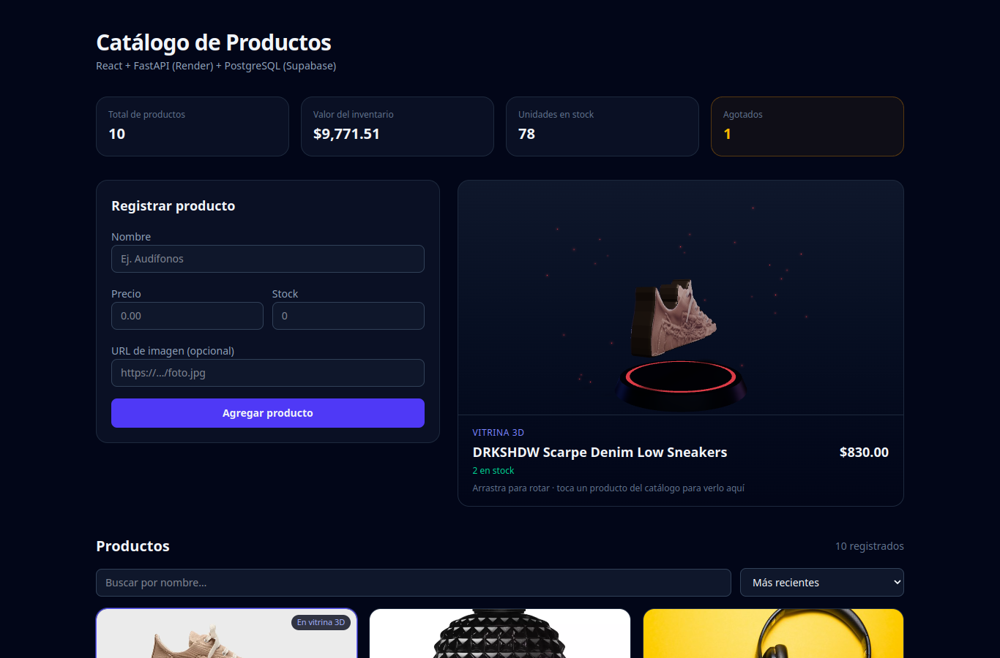
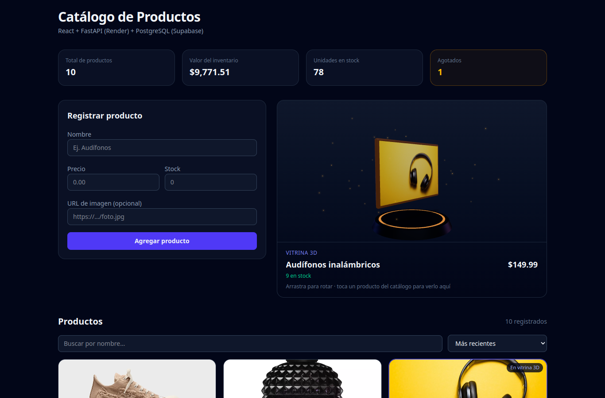
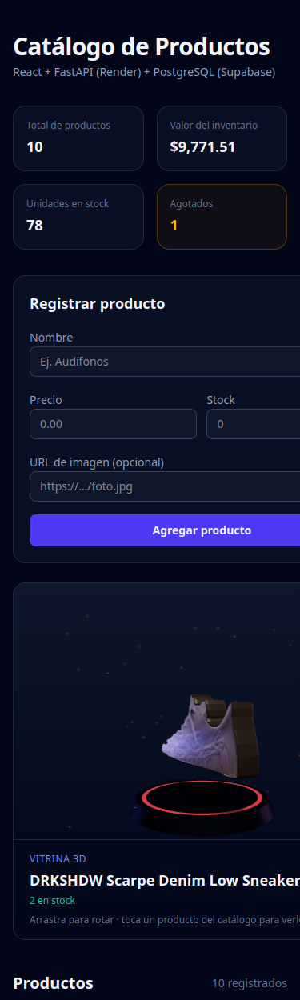
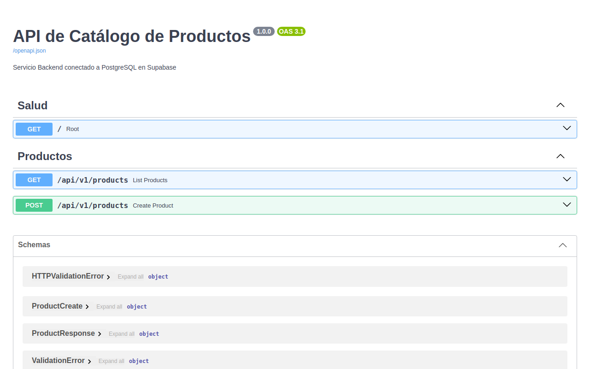

# Informe — Proyecto Final: Catálogo de Productos 3D

## 1. Enlaces

| Entregable | URL |
|---|---|
| Frontend (Vercel) | https://catalogo-productos-3d.vercel.app |
| API (Render) — Swagger | https://api-productos-buza.onrender.com/docs |
| Repositorio (GitHub) | https://github.com/lea11111111/catalogo-productos-3d |

> La API está en el plan gratuito de Render: si lleva un rato sin uso, la primera carga tarda hasta ~50 s. La app muestra el aviso "Despertando el servidor…" mientras tanto.

## 2. Descripción

Aplicación web para **registrar y listar productos**. Los datos se guardan en PostgreSQL (Supabase), los expone una API REST en FastAPI (Render) y los consume un frontend React (Vercel) con una **vitrina 3D interactiva**.

### Arquitectura

```
Frontend (Vercel)            API FastAPI (Render)          Base de datos
React + Vite + Tailwind  ──▶ SQLAlchemy + Pydantic    ──▶ Supabase (PostgreSQL)
+ React Three Fiber (3D) ◀── GET / POST /api/v1/products   tabla products
                                     │
                                     └─▶ Slack (webhook al crear producto)
```

### Modelo de datos (tabla `products`)

| Columna | Tipo | Restricciones |
|---|---|---|
| id | bigint identity | PK |
| name | text | NOT NULL |
| price | numeric | NOT NULL, ≥ 0 |
| stock | integer | DEFAULT 0, ≥ 0 |
| image_url | text | opcional |
| created_at | timestamptz | DEFAULT now() |

### API

| Método | Ruta | Respuesta |
|---|---|---|
| GET | `/api/v1/products` | 200 — lista (más recientes primero) |
| POST | `/api/v1/products` | 201 — producto creado · 422 si los datos no son válidos |
| PUT | `/api/v1/products/{id}` | 200 — producto editado · 404 si no existe |
| DELETE | `/api/v1/products/{id}` | 204 — producto eliminado |
| GET | `/docs` | Swagger UI |

## 3. Funcionalidades

- **RF1** Listado al cargar, con esqueletos de carga.
- **RF2** Formulario con validación (nombre obligatorio, precio ≥ 0, stock entero ≥ 0).
- **RF3** El producto creado aparece al instante sin recargar.
- **RF4** **Vitrina 3D**: la app quita el fondo de la foto del producto (relleno por inundación desde los bordes), calcula un campo de distancias (chamfer 3-4) y "infla" la silueta con un perfil de sección circular, generando una malla 3D cerrada con volumen; si el fondo no es liso, usa una tarjeta con la foto. La figura gira sobre un pedestal con anillo de luz, iluminación de estudio y partículas. Se rota con el cursor o el dedo.
- **RF5** Mensajes de error en español y botón "Reintentar" si la API no responde.
- **RF6** Diseño responsivo (probado a 375 px y 1366 px, sin scroll horizontal).

**Extras:**
- Editar y eliminar productos (PUT / DELETE), con vista previa que valida la URL de la imagen.
- Clic en cualquier producto del catálogo → se muestra en la vitrina 3D.
- Panel de estadísticas: total de productos, valor del inventario, unidades en stock y agotados.
- Buscador (ignora mayúsculas y acentos) y orden por fecha, precio o nombre.
- Aviso con contador mientras Render "despierta".
- Notificación a Slack al crear un producto (si `SLACK_WEBHOOK_URL` está configurada).

## 4. Capturas

| Escritorio | Selección en la vitrina 3D | Móvil |
|---|---|---|
|  |  |  |

Vitrina 3D: 

API en Render (Swagger): 

## 5. Herramientas

| # | Herramienta | Uso en el proyecto | Evidencia |
|---|---|---|---|
| 1 | Devin AI | _(completar)_ | _(pegar prompt y captura/log de la sesión)_ |
| 2 | Slack | Canal `#deploy-proyectos` con avisos de despliegue o de productos creados | _(captura del canal)_ |
| 3 | Vercel | Hosting del frontend | https://catalogo-productos-3d.vercel.app |
| 4 | Comentera | Revisión visual de la UI | _(captura de ≥ 2 comentarios)_ |
| 5 | Gráficos 3D | Vitrina con `three`, `@react-three/fiber` y `@react-three/drei` | Sección 4 |
| 6 | Supabase / Render | Base de datos PostgreSQL + API FastAPI | _(captura del Table Editor)_ · https://api-productos-buza.onrender.com/docs |

### Prompt usado para Devin

> Crea una SPA en React con Vite y Tailwind CSS que consuma una API REST de productos (GET y POST a `${VITE_API_URL}/api/v1/products`). Incluye un formulario para agregar productos (nombre, precio, stock, URL de imagen), un grid con los productos, estados de carga y error, y una tarjeta con un visor 3D interactivo (`@react-three/fiber` + `@react-three/drei`) para el producto destacado.

_(Ajustar si el prompt que usaste fue otro y agregar el log.)_

## 6. Seguridad

- El `.env` y las contraseñas no están en el repositorio (`.gitignore`); `DATABASE_URL` y `SLACK_WEBHOOK_URL` solo existen como variables de entorno en Render.
- Supabase tiene RLS activo: la API pública de Supabase solo permite lectura; las escrituras pasan por FastAPI.
- Validación de datos en el backend (Pydantic) y en la base (`CHECK price >= 0`, `CHECK stock >= 0`).

## 7. Rúbrica

| Criterio | Estado |
|---|---|
| BD: registros reales en Supabase | ✅ |
| API: GET 200 / POST 201 en Render | ✅ |
| Frontend en Vercel | ✅ |
| 3D interactivo | ✅ |
| Devin: prompt + log | ☐ |
| Slack: alertas | ☐ |
| Comentera: ≥ 2 comentarios | ☐ |
