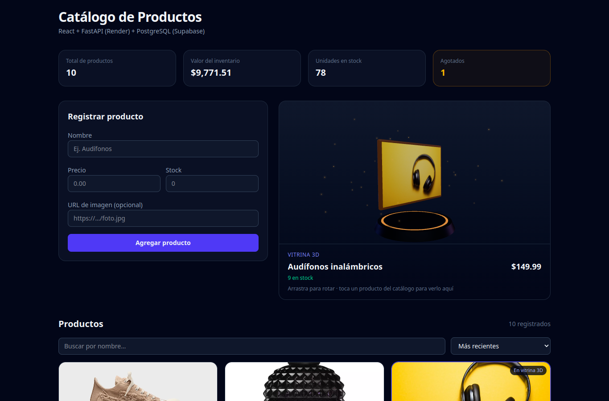
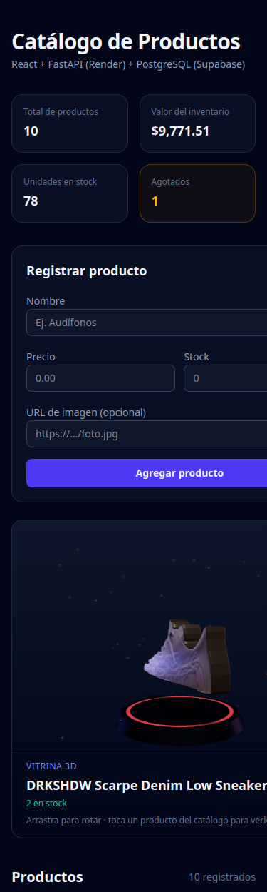
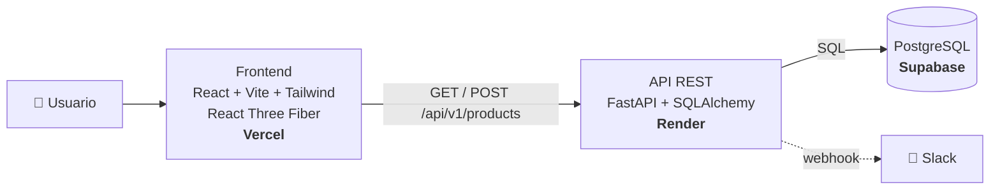

# 🛍️ Catálogo de Productos 3D

Aplicación web para **registrar y explorar productos** con una **vitrina 3D interactiva**.
Frontend en React (Vercel), API en FastAPI (Render) y base de datos PostgreSQL (Supabase).

**🔗 [Ver la app en vivo](https://catalogo-productos-3d.vercel.app)** · **📘 [API / Swagger](https://api-productos-buza.onrender.com/docs)** · **📄 [Informe](INFORME.md)**



> ⏱️ La API usa el plan gratuito de Render: tras un rato sin uso, la primera carga tarda hasta ~50 s. La app avisa con "Despertando el servidor…".

---

## ✨ Funcionalidades

| | |
|---|---|
| 🧊 **Vitrina 3D** | La app quita el fondo de la foto, traza la silueta del producto y la "infla" en una figura 3D con volumen redondeado que gira sobre un pedestal con luz. Se rota con el cursor o el dedo. |
| 👆 **Clic para ver en 3D** | Al tocar cualquier producto del catálogo, aparece en la vitrina. |
| ✏️ **Editar y eliminar** | Botones en cada producto; el formulario avisa si la URL de imagen no es válida. |
| ➕ **Registro de productos** | Formulario con validación (nombre, precio ≥ 0, stock ≥ 0, URL de imagen). Se agrega sin recargar. |
| 📊 **Estadísticas** | Total de productos, valor del inventario, unidades en stock y agotados. |
| 🔎 **Búsqueda y orden** | Busca sin importar mayúsculas ni acentos; ordena por fecha, precio o nombre. |
| 📱 **Responsivo** | Funciona en celular y escritorio. |
| 🛡️ **A prueba de fallos** | Si el navegador bloquea WebGL, muestra la foto en plano y el resto sigue funcionando. |
| 🔔 **Slack** | Aviso al canal cuando se crea un producto (webhook opcional). |

<p align="center">
  <br>
  
</p>

## 🏗️ Arquitectura



| Capa | Tecnologías |
|---|---|
| Frontend | React 19, Vite, Tailwind CSS v4, three.js, @react-three/fiber, @react-three/drei |
| Backend | Python 3.12, FastAPI, SQLAlchemy, Pydantic, Uvicorn |
| Base de datos | PostgreSQL en Supabase (SQLite en local) |
| Despliegue | Vercel (frontend) · Render (API) |

## 🔌 API

| Método | Ruta | Respuesta |
|---|---|---|
| `GET` | `/api/v1/products` | `200` — lista de productos (más recientes primero) |
| `POST` | `/api/v1/products` | `201` — producto creado · `422` si los datos no son válidos |
| `PUT` | `/api/v1/products/{id}` | `200` — producto editado · `404` si no existe |
| `DELETE` | `/api/v1/products/{id}` | `204` — producto eliminado |
| `GET` | `/docs` | Documentación interactiva (Swagger) |

Ejemplo:

```bash
curl -X POST https://api-productos-buza.onrender.com/api/v1/products \
  -H "Content-Type: application/json" \
  -d '{"name":"Mouse inalámbrico","price":25.5,"stock":10,"image_url":null}'
```

### Tabla `products`

| Columna | Tipo | Restricciones |
|---|---|---|
| `id` | bigint identity | PK |
| `name` | text | NOT NULL |
| `price` | numeric | NOT NULL, ≥ 0 |
| `stock` | integer | DEFAULT 0, ≥ 0 |
| `image_url` | text | opcional |
| `created_at` | timestamptz | DEFAULT now() |

## 📁 Estructura

```
├── backend/              API FastAPI
│   ├── main.py           Rutas GET / POST
│   ├── models.py         Modelo SQLAlchemy
│   ├── schemas.py        Validación Pydantic
│   ├── database.py       Conexión (Supabase o SQLite)
│   └── notifications.py  Aviso a Slack
├── frontend/             App React
│   └── src/components/   Vitrina 3D, formulario, catálogo, estadísticas…
├── render.yaml           Despliegue de la API en Render (Blueprint)
├── docs/capturas/        Capturas de pantalla
├── ESPECIFICACIONES.md   Requisitos del proyecto
└── INFORME.md            Informe de entrega
```

## 💻 Ejecutar en local

**Backend** (usa SQLite si no hay `DATABASE_URL`):

```bash
cd backend
python -m venv venv
source venv/bin/activate        # Windows: venv\Scripts\activate
pip install -r requirements.txt
uvicorn main:app --reload --port 8000
```

**Frontend:**

```bash
cd frontend
npm install
echo "VITE_API_URL=http://127.0.0.1:8000" > .env
npm run dev
```

## 🔐 Variables de entorno

| Variable | Dónde | Descripción |
|---|---|---|
| `DATABASE_URL` | Render | Cadena del *Session pooler* de Supabase |
| `SLACK_WEBHOOK_URL` | Render | Webhook de Slack (opcional) |
| `CORS_ORIGINS` | Render | Orígenes permitidos (por defecto `*`) |
| `VITE_API_URL` | Vercel | URL pública de la API |

Las credenciales nunca se suben al repositorio (`.env` está en `.gitignore`).
